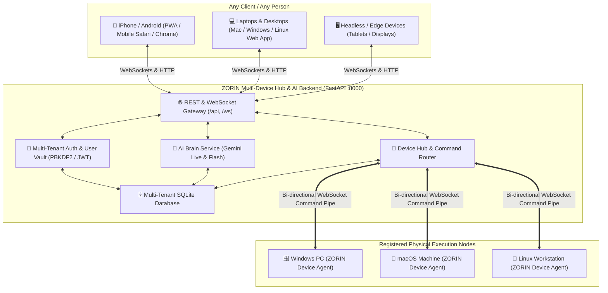

# 🌐 ZORIN Multi-Device & Multi-User Architecture Guide

Welcome to the **ZORIN Multi-Device Platform**. ZORIN is now fully transformed from a local desktop-only script into a complete, cross-device AI assistant accessible from **any smartphone, tablet, laptop, desktop, or web browser**, with isolated multi-user accounts and cross-device remote execution.

---

## 🏗️ System Architecture



---

## 🌟 Key Capabilities

### 1. 📱 Universal Access ("Any Device")
- **Mobile Phones & Tablets (iOS / Android)**:
  - Open the web app on Safari or Chrome (`http://<your-ip>:8000`).
  - Install to Home Screen with one tap (**PWA** standalone mode with native app feel).
  - Use voice input (browser speech recognition) or text chat with sound visualizer.
  - Spoken voice feedback with natural speech synthesis.
- **Laptops & Desktops (Mac, Windows, Linux)**:
  - High-resolution dashboard with device health monitoring, quick action triggers, and live memory inspector.

### 2. 👥 Multi-User & Multi-Tenant ("Any Person")
- Complete user registration (`/api/auth/register`) and login (`/api/auth/login`).
- Every person gets their own **isolated long-term memory vault**, conversation logs, and paired device ecosystem.
- Default pre-configured user (`niharika@zorin.ai` / `password123`) is ready for immediate testing.

### 3. ⚡ Cross-Device Remote Execution
- Speak or type on your **phone** in another room:
  - *"Open VS Code on my laptop"*
  - *"Launch Chrome and go to YouTube on my computer"*
  - *"Create a modern portfolio website for a designer"*
- ZORIN's AI brain parses the instruction, resolves your target computer node via the **Device Connection Hub**, transmits the command over an encrypted WebSocket pipe, and executes it physically on your machine!

### 4. 🧠 Cross-Device Persistent Memory
- Facts and preferences you mention on your phone are instantly remembered when using your computer or tablet.

---

## 🚀 Quick Start Guide

### Step 1: Start the ZORIN Multi-Device Hub
On your main computer / server:
```powershell
# Using the Windows Batch script:
.\START_SERVER.bat

# Or directly in PowerShell:
.\.venv\Scripts\python.exe start_server.py
```
This starts the server on `0.0.0.0:8000` and displays your local IP address:
```
  ● Desktop / Laptop Access: http://localhost:8000
  ● Phone / Tablet Access:   http://192.168.x.x:8000
```

---

### Step 2: Access from Your Phone or Any Other Device
1. Connect your phone to the same Wi-Fi network as your computer.
2. Open Safari (iPhone) or Chrome (Android) and navigate to:
   ```
   http://<YOUR_COMPUTER_IP>:8000
   ```
3. *(Optional)* Tap **Share** ➡️ **Add to Home Screen** to install ZORIN as a native app on your mobile device.

---

### Step 3: Run the Device Agent on Your Computers
To allow ZORIN to open apps, websites, and files on your Windows, Mac, or Linux computer:
```powershell
# Using the Batch script:
.\START_DEVICE_AGENT.bat

# Or via Python:
.\.venv\Scripts\python.exe start_device_agent.py
```
The agent connects instantly to the Multi-Device Hub over WebSockets, registering its local capabilities (`open_app`, `open_website`, `create_website`).

---

## 🛠️ File Structure

| Path | Purpose |
| :--- | :--- |
| `backend/server.py` | FastAPI master server with REST endpoints, WebSockets, and static PWA host. |
| `backend/device_hub.py` | Real-time WebSocket connection manager and remote command dispatcher. |
| `backend/assistant_service.py` | Multi-device AI conversational engine powered by Gemini with memory injection. |
| `backend/auth.py` | Multi-user PBKDF2 authentication, JWT tokens, and user profile management. |
| `backend/database.py` | Multi-tenant SQLite database schema (`users`, `devices`, `remote_commands`, `memories`). |
| `backend/static/` | Universal Progressive Web App (`index.html`, `style.css`, `app.js`, `manifest.json`, `service-worker.js`). |
| `device/agent.py` | Cross-platform background daemon that executes dispatched actions on physical machines. |
| `device/controller_factory.py` | Cross-platform controller factory supporting Windows, macOS, Linux, and Mobile. |
| `device/windows/` | Windows app launcher and controller (`open_app`, `open_website`, `create_website`). |
| `device/darwin/` | macOS app launcher (`open -a`, AppleScript). |
| `device/linux/` | Linux app launcher (`gtk-launch`, `xdg-open`). |
| `start_server.py` | One-click server launcher with network IP detection. |
| `start_device_agent.py` | One-click device daemon launcher. |
| `test_multi_device.py` | Complete test suite for multi-device architecture. |
| `test_remote_execution.py`| Verification test for real-time WebSocket command routing. |
